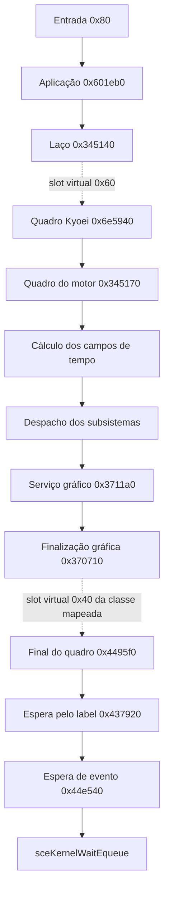
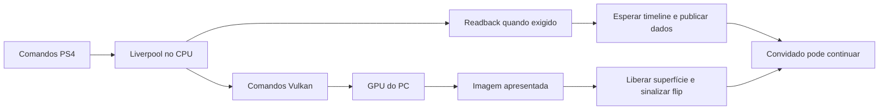

# Mapa estático do quadro, tempo e HUD

Investigação de 15/10/2026, CUSA03562 01.03. Nenhum jogo executado nesta etapa.
O mapa localiza o controlador de quadro, o cálculo de tempo e dois caminhos
da HUD, ligando-os às esperas e à apresentação do runtime Windows. Não é uma
engenharia reversa completa de todas as funções nem uma medição de desempenho.

## Evidência e reprodução

Fonte: `eboot.elf` reconstruído pelo preparador a partir do dump registrado
no M0. SHA-256 do ELF: `1968814b70f69ec85ff3e556c4b66b53ec298c0dea71120e4f0ba594906e418e`.
Esse hash difere do SELF e da imagem carregável; não são arquivos equivalentes.
Os endereços abaixo são relativos à imagem original, antes das adaptações do
runtime. Na base Windows atual, somar `0x800000000` para obter endereços carregados.

O ELF contém um índice GNU de unwind com 42.194 intervalos de função. Cada
intervalo foi conferido contra o FDE correspondente, a codificação CIE e os
segmentos executáveis. O número não prova cobertura de todas as funções.
O analisador procura candidatos CALL/JMP, mas só aceita uma ligação quando
o LLVM a decodifica na mesma posição, começando no limite de função do FDE.
As entradas PLT são relacionadas às relocações de importação de `boot.bin`.

```powershell
python tools/inspect_frame_flow.py G:/kyoei-toshi-work/native-05/out --facts docs/re/frame-flow-facts.json --depth 2 --out build/frame-flow-map.json
python tools/test_frame_flow.py
```

Resultado: 75 funções desmontadas, 90 ligações a chamadores verificadas,
254 instruções de chamada indireta identificadas, nenhum erro de decodificação
reportado e limite de funções não atingido. São chamadas presentes no código,
não contagens de execução. O relatório inclui chamadas diretas de saída e
hashes de funções. Os seis conjuntos de leituras do arquivo de fatos passaram.
Dois encaixes de chamadas virtuais também passaram na conferência de instrução,
offset e tabela; o receptor ativo em cada cena continua sem prova dinâmica.

Só ferramentas e metadados técnicos entram no Git. ELF, imagem, desmontagem
e recursos continuam privados. Os nomes descritivos no mapa foram atribuídos
durante a análise; não são símbolos originais recuperados.

## Entrada e controlador de quadro

| Endereço | Papel observado | Evidência |
| --- | --- | --- |
| `0x80` | Entrada do executável | Chama `0x601eb0` em `0xba` |
| `0x601eb0` | Rotina principal da aplicação | Constrói o objeto; chama inicialização, laço e encerramento |
| `0x343f80` | Construtor base | Registra objeto global em `0x13361f0`, inicializa execução e tempo |
| `0x345140` | Laço da aplicação | Enquanto objeto+`0xcc` não for zero, chama slot virtual `0x60` |
| `0x6e5940` | Implementação de quadro do Kyoei | Entrada no slot `0x60` da tabela instalada pela rotina principal |
| `0x345170` | Orquestração de quadro do motor | Chamado em `0x6e5c3c`; calcula tempo e despacha subsistemas |
| `0x344980` | Encerramento da aplicação | Libera subsistemas; não deve ser confundido com atualização |

Na rotina principal, `0x601edf` carrega a tabela `0x127bdc8`, instalada no
objeto em `0x601ef8`. O slot `+0x60` contém `0x6e5940`. O laço usa esse slot
em `0x345156`. A implementação do Kyoei incrementa objeto+`0x3294`, executa
tratamento próprio e chama a implementação base em `0x6e5c3c`.



As setas pontilhadas dependem do objeto/tabela usados. A sequência acima não
representa todas as tarefas paralelas nem implica que cada ramo execute em
todas as cenas. O motor despacha muitos subsistemas por tabelas virtuais;
não atribuir nomes como física, IA ou HUD a slots ainda não resolvidos.

## Tempo: por que há uma hipótese concreta para a câmera lenta

O construtor escreve modo `1` em objeto+`0xe8`. O vetor de valores iniciais
para `+0xec..+0xf8` é aproximadamente `[1, 1/60, 1, 15]`. Na rotina do motor:

| Campo da aplicação | Uso observado |
| --- | --- |
| `+0xe8` | Seleciona um de dois cálculos de tempo; não zero escolhe passo fixo |
| `+0xec` | Multiplicador usado nos dois cálculos; inicialmente 1 |
| `+0xf0` | Resultado em segundos, consumido por atualizações do Kyoei |
| `+0xf4` | Segundo resultado, fator relativo à taxa-alvo |
| `+0xf8` | Limite inferior usado no ramo com taxa medida; inicialmente 15 |

Se chamarmos o multiplicador de `S`, a taxa-alvo de `R` e a taxa medida do
subsistema gráfico de `F`, as operações em `0x34519a..0x345214` equivalem a:

- Modo não zero: `+0xf0 = S / R`; `+0xf4 = S`.
- Modo zero: `M = max(+0xf8, F)`; `+0xf0 = S / M`; `+0xf4 = S * M / R`.

São fórmulas reconstruídas de instruções, não nomes originais dos campos.
`R` vem de `0x36c280`, que lê o seletor `+0xa0` do subsistema gráfico.
Sua tabela contém `[60, -1, 60, 30, 20]`; seletores fora de 0..4 têm outro
fallback, não analisado semanticamente aqui. O significado de cada modo,
especialmente `-1`, continua pendente.

`F` é armazenado no subsistema gráfico+`0xc0` por `0x3708d0`. O caminho usa
`0x3230a0` para diferença entre timestamps, `0x323080` para atualizar o timestamp
e as importações de `sceKernelGetProcessTime`. Há normalização para nanossegundos
e divisão por `1.000.000.000`. Esse relógio interno não é a série de FPS
agregada que o nosso runtime registra a cada 120 apresentações.

Há consumidores concretos de aplicação+`0xf0` dentro de `0x6e5940`: por exemplo,
`0x6e60a6` multiplica uma taxa por esse campo e `0x6e60ae` soma o incremento
ao estado; há outros consumidores em `0x6e6177` e `0x6e6aab`. Não identificamos
esses objetos como movimento do personagem ou física. Eles provam que o valor
participa de atualizações reais, não apenas de um contador de FPS.

**Inferência:** se o ramo fixo continuar ativo a 60 e uma atualização ocorrer
por apresentação, executar só 20 atualizações por segundo fará consumidores
desse passo avançarem 1/3 de segundo por segundo real. Isso é compatível com
slow motion. A inspeção estática não prova o modo ativo na cidade, possíveis
mudanças posteriores dos campos, nem como todos os sistemas consomem o tempo.

Não alterar `+0xe8`, `+0xf0` ou a tabela de taxas agora. Trocar o modo pode
afetar animação, física, scripts, QTEs e cutscenes. Próxima prova necessária:
observar esses campos e a frequência das rotinas em cena fixa, sem escrever.

## Taxa de apresentação e as esperas do jogo

`0x370710` usa o mesmo seletor gráfico+`0xa0` para uma tabela de flip rates
em `0x102b580`: `[0, 0, 0, 1, 2]`. O valor segue para
`sceVideoOutSetFlipRate` em `0x3707b0`. Isso liga os modos de 30 e 20 da tabela
à solicitação de pular ciclos de apresentação, mas não significa que esses
modos estejam ativos. Os registros Windows anteriores mostraram rate 0.

| Caminho | Ligação confirmada | Implicação |
| --- | --- | --- |
| Envio gráfico | `0x460700` → `0x42b490` → PLT `0xccf940` | Chega a `sceGnmSubmitAndFlipCommandBuffers` |
| Finalização | `0x4495f0` → `0x42b4e0` → PLT `0xccf990` | Chama `sceGnmSubmitDone` depois da espera de label |
| Espera por evento | `0x4495f0` → `0x437920` → `0x44e540` → PLT `0xcd0970` | Chega a `sceKernelWaitEqueue`, com timeout nulo |
| Polling da GPU | `0x436500` → `0x4330b0` | Existe também uma espera por valor real em memória |

O contexto por quadro usa stride `0xcc00`. Em `0x437920`, o ponteiro de label
fica em registro+`0xcbb8` e o valor esperado em `+0xcbc8`. Enquanto os valores
não conferem, chama a espera de evento e verifica novamente. Depois há outro
ramo de polling condicionado por estado global e flag do registro. Logo,
o custo de uma espera não se resume à rotina já adaptada `0x4330b0`.

`0x4330b0` compara um valor de 64 bits e tem limite de 10.000.000 de iterações
antes do caminho de diagnóstico/trap. O nosso adaptador já instalado espera
cooperativamente antes de entrar nessa rotina original; não publica conclusão.

A chamada virtual `0x3707cf` usa slot `0x40`. A tabela `0x1262920` contém
`0x4495f0` nesse slot. Essa resolução de classe foi conferida, mas ainda é
preciso observar que essa classe ocupa o receptor gráfico+`0x11958` na cena
medida. Não converter esse encaixe estático em uma medição de custo.

## Integração até a GPU do Windows

O código integrado por `CMakeLists.txt` permite seguir o lado host sem novas
suposições sobre o executável:

1. `sceGnmSubmitAndFlipCommandBuffers` prepara a submissão; o caminho gráfico
   chega a `Liverpool::SubmitGfx`. Nossa integração mantém cópias próprias dos
   comandos para o jogo não reutilizar armazenamento ainda em processamento.
2. `Liverpool::Process` executa os comandos. Eventos EOP/EOS/ReleaseMem podem
   exigir `ProcessDownloadImages` antes de publicar resultados ao jogo.
3. O readback chega ao scheduler. `Scheduler::Finish` submete e espera a timeline;
   não equivale a apenas enviar comandos à GPU.
4. `VideoOutDriver::SubmitFlipInternal` prepara a imagem e a coloca na fila.
   `PresentThread` consome a fila na frequência de vblank e respeita flip rate.
5. `Flip` apresenta a imagem; depois libera a superfície anterior, atualiza
   status e publica eventos ao jogo. A ordem de liberação já tem testes de corrida.



As métricas `command-batch`, `scheduler-wait`, `readback-finish`, `prepare`,
`present` e `present-pacing` agora têm um contexto estrutural. Elas podem estar
aninhadas ou em threads diferentes. Sua soma não é o custo de um quadro.
Ainda faltam timestamps GPU e correlação com as fases da aplicação convidada.

## HUD: caminhos distintos antes do rasterizador

O marcador de interação tem um caminho específico:

- `0xa6cee0` carrega o recurso técnico `common/hud/cmnd_marker/cmnd_marker`
  e chama `0xa6d9a0` em `0xa6d2cf`.
- `0xa1bc00` também chama `0xa6d9a0`, em `0xa1de11`.
- `0xa6d9a0` manipula texto/nós e usa contagem de caracteres e campos do nó
  para ajustar a placa. Não é o medidor geral de linha.

O texto da fonte bitmap tem outro caminho: vários consumidores entram em
`0x2e0cf0`, que chama `0x2e2b10` em `0x2e10b7`. Esse último mede uma linha
e produz campos de fim, quebra e overflow. É a rotina da adaptação de quebra
por palavras. Não se deve deduzir que corrigir esse medidor conserta placas
dimensionadas por contagem de caracteres, nem fazer o contrário.

O minimapa ainda tem seus próprios consumidores conhecidos em `0xa5bff0` e
`0xa5f4a5`. Detalhes e histórico das adaptações estão em
[HUD-INVESTIGACAO.md](../m3/HUD-INVESTIGACAO.md). A ligação direta entre o
dispatcher do quadro e cada objeto de HUD continua pendente de resolução
das classes/coleções intermediárias; não foi inventada uma chamada direta.

## Próximas provas a partir deste mapa

| Questão | Observação necessária | O que ela decide |
| --- | --- | --- |
| Passo fixo está ativo? | Aplicação+`0xe8/ec/f0/f4/f8`, seletor gráfico+`0xa0` e taxa+`0xc0` | Se a hipótese de slow motion corresponde à cena |
| Onde o quadro demora? | Início/fim de `0x6e5940`, `0x345170`, `0x437920`, `0x4330b0`, junto às métricas host | Trabalho convidado versus espera do renderer |
| Qual passagem gasta GPU? | Timestamps Vulkan e dependências de readback | Renderização versus custo de envio/CPU |
| Qual HUD está errada? | Classe ativa, nó, texto e resultado dos dois caminhos de medição | Placa, texto ou transformação/recorte |

Neste checkpoint foram produzidos mapa, ferramenta e testes estáticos. Nenhuma
troca de timestep, redução de qualidade ou ganho de FPS foi aplicada/declarada.
