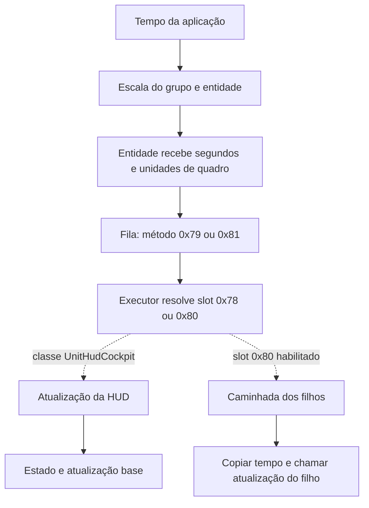

# Tempo, tarefas e entidades: aprofundamento estático

15/10/2026, CUSA03562 01.03. Continuação de
[QUADRO-HUD-TEMPO.md](QUADRO-HUD-TEMPO.md), sem abrir ou executar o jogo.

## O que mudou no entendimento

O Kyoei não apenas herda o modo fixo inicial do motor: seu estágio 44 de
inicialização troca o seletor para tempo medido. Também há um multiplicador
controlável pelo binding `setDeltaTimeFactor`, escalas por grupo/entidade e
uma cadeia de tarefas que entrega a atualização à HUD. Isso torna incorreto
atribuir a câmera lenta apenas ao padrão do construtor.

Ainda não foi provado o estado desses campos na cidade, nem qual trecho
domina o custo do quadro. A implementação de física e a velocidade real do
personagem não foram identificadas nesta etapa. Nenhum patch de tempo foi feito.

## Índice de instruções e limites da análise

`tools/index_guest_code.py` produziu `build/research/guest-code.sqlite`, privado:

- 42.194 intervalos de função, com cobertura contígua de instruções conferida.
- 2.929.970 instruções indexadas, zero intervalos com erro de decodificação.
- Nenhuma função precisou ser desmontada novamente a partir de sua entrada.
- Integridade SQLite conferida. Nenhum código convidado executado.

Isso é cobertura estrutural de desmontagem, não compreensão completa de
2,9 milhões de instruções. O banco contém desmontagem e nunca deve entrar
no Git ou em uma entrega. O ELF permanece vinculado ao SHA-256 registrado
no arquivo de fatos da análise anterior.

`tools/trace_guest_fields.py` segue ponteiros de objetos identificados por
globais e receptores de funções. Propaga cópias de registradores, faz interseção
dos estados nos encontros de caminhos e elimina registradores voláteis após
chamadas. Escritas parciais, operações implícitas, troca de registradores e
prefixos atômicos/de cópia têm casos conservadores. Não executa bytecode.

O relatório atual cobre 1.692 funções selecionadas, 1.334 acessos ou endereços
de campos, 2.196 chamadas com argumentos de objetos reconhecidos e 19 chamadas
virtuais com origem reconhecida. Permanecem 361 desvios indiretos não resolvidos
nessas funções. Não modela spills de ponteiros na pilha, aliases arbitrários de
heap nem efeitos interprocedurais completos: referências ausentes não provam
que uma escrita ou consumidor não exista.

A tabela de 45 estágios da inicialização é uma exceção explicitamente descrita
e validada em `field-trace-facts.json`. Todos os seus destinos precisam ser
instruções decodificadas dentro da função declarada.

## Inicialização: o modo fixo é substituído

`0x3440c0` recebe o objeto da aplicação em RSI; RDI é a saída de retorno por
estrutura. Esse detalhe evita confundir o objeto com um buffer temporário.
O laço em `0x3442a0..0x3442d0` passa o índice de estágio em EDX ao slot
virtual `+0x38`, cujo destino da classe do Kyoei é `0x6dfda0`.

| Evidência | Resultado |
| --- | --- |
| `0x343f80`, escrita em `0x344015` | Construtor base: aplicação+`0xe8 = 1` |
| Tabela `0x107ae10`, 45 entradas relativas | Entrada 44 aponta a `0x6e089f` |
| `0x6dfdbf` | RBX recebe o objeto da aplicação de RDI |
| `0x6e08a6` | Estágio 44 escreve aplicação+`0xe8 = 0` |
| `0x34519a` | O quadro escolhe o cálculo conforme esse campo |

São as duas escritas diretas nesse campo reconhecidas pelo rastreador atual.
Não é uma prova de inexistência de outras escritas, particularmente em módulos
de fases, aliases não resolvidos, cópias de estruturas ou memória escrita por
outro caminho. O fluxo encontrado, porém, invalida usar só o construtor base
como explicação do jogo depois de inicializado.

## Multiplicadores e propagação do tempo

O binding técnico `setDeltaTimeFactor` aparece no par de tabela em
`0x12794d0/0x12794d8`: nome em `0x108abc6`, callback `0x603ff0`.
O callback obtém um valor numérico e o grava em aplicação+`0xec` em `0x604026`.
Há também caminhos que restauram esse campo para `1.0`, incluindo `0x675229`
e `0x6752d5`. Não alterar essas escritas como se fossem bugs: podem compor
efeitos e transições intencionais.

Nos 299 chunks `.luc` da extração M1 pesquisada não apareceu esse nome.
Isso não significa que o binding seja inútil ou que nenhum script carregado
o use: a extração não equivale a todos os módulos/recursos que o jogo pode carregar.

O rastreador reconheceu 126 leituras de aplicação+`0xf0` em 92 funções.
São ocorrências estáticas identificadas, não chamadas por quadro ou duração.
Uma delas fecha a propagação do tempo para as entidades:

1. O slot `+0x30` do gestor global `0x1336200` aponta a `0x3542e0`.
2. Esse método chama `0x354be0` em `0x354365`, por grupo.
3. `0x354c27` calcula tempo do grupo: aplicação+`0xf0` × grupo+`0x2c`.
4. Para cada entidade, `0x354c89` multiplica pelo fator entidade+`0x10`.
5. Se o bit `0x10` de entidade+`0x20` estiver ligado, aplica também
   gestor+`0x1a8`. O construtor desse gestor inicializa o fator em `1.0`.
6. `0x354ca9` grava entidade+`0x14` em segundos. `0x354cae` grava
   entidade+`0x18`, o mesmo valor multiplicado pela taxa-alvo.

Isso mostra onde separar tempo global, efeito de grupo e efeito de entidade.
Ainda não identifica automaticamente o grupo ou entidade do jogador em uma cena.

## As fases do gestor e a fila de tarefas

`0x353220` registra o gestor em `0x1336200` e instala a tabela `0x125a2f8`.
O quadro do motor chama cinco fases desta tabela:

| Slot do gestor | Chamada no quadro | Destino |
| --- | --- | --- |
| `0x30` | `0x3452c8` | `0x3542e0` |
| `0x38` | `0x3452d1` | `0x354e30` |
| `0x40` | `0x3452ed` | `0x354f80` |
| `0x48` | `0x3452f6` | `0x3558c0` |
| `0x50` | `0x3452ff` | `0x355970` |

Os nomes acima usam offsets para evitar inventar a finalidade de cada fase.
Há filtros de estado e flags antes de cada despacho; objeto presente na lista
não implica que seu callback execute naquele quadro.

A aplicação mantém o gestor de tarefas em `+0xd8`. `0x3440c0` escolhe entre
duas tabelas conforme configuração+`0x10`. A rotina principal grava `1` nesse
campo em `0x6024a1`, escolhendo o caminho da tabela `0x1259d00` no fluxo observado
estaticamente. A outra tabela é `0x1259c68`.

`0x3222f0` e `0x3223c0` acrescentam registros de 48 bytes à fila:

| Offset do registro | Uso observado |
| --- | --- |
| `+0x8` | Objeto/receptor |
| `+0x10` | Tipo de chamada: 0, 1 ou 2 |
| `+0x18` | Argumento extra no tipo 2 |
| `+0x20` | Código de função ou identificador de método virtual |
| `+0x28` | Ajuste do ponteiro do receptor |

A capacidade vem de gestor+`0x40`, o armazenamento de `+0x48` e o índice de
inserção de `+0x5c`. Fila cheia devolve `-1`; não há alocação em cada inserção
dessas duas rotinas.

O executor `0x345970` aplica o ajuste do receptor. Se o identificador é ímpar,
carrega a tabela virtual e resolve `identificador - 1`; se é par, usa-o como
endereço direto. Exemplos confirmados nos produtores:

| Identificador | Slot resolvido | Produtor |
| --- | --- | --- |
| `0x71` | `0x70` | Propagação/inicialização por grupo, `0x354be0` |
| `0x79` | `0x78` | Caminhada de atualização, `0x354ea0` |
| `0x81` | `0x80` | Caminhada em `0x3557e0` |
| `0x91` | `0x90` | Fase `0x355970` |

A fase `0x40` também divide trabalho em intervalos e enfileira funções como
`0x3868b0`, com dados próprios por intervalo. As chamadas `+0x60` ali pertencem
ao gestor de tarefas, não ao objeto de HUD. Esse detalhe evita uma falsa
resolução de chamada só porque o offset virtual é igual.

As wrappers `0x345630/0x345750` podem ativar trabalhadores depois de inserir
tarefas. `0x3457e0` verifica a quantidade pendente, flags e limiar antes de
sinalizar os trabalhadores. Não há evidência de uma sinalização incondicional
por tarefa. Não desativar threads ou trocar a fila por execução imediata por palpite.

## Ligação concreta à HUD

O registro técnico `UnitHudCockpit` é iniciado em `0xa53330`. Ele associa o
construtor `0xa535d0`, que aloca 448 bytes e instala a tabela `0x12d7bb8`.

| Slot da classe | Destino | Papel identificado |
| --- | --- | --- |
| `0x78` | `0xa53090` | Atualização própria e despacho conforme estado `+0x174` |
| `0x80` | `0x2efed0` | Porta para atualizar filhos, condicionada ao bit `0x2` de `+0x170` |
| `0x90` | `0xa530f0` | Tratamento do estado `+0x184` e possível despacho ao slot `0x150` |
| `0xd8` | `0x2f0160` | Caminhada pelos filhos para atualizar objetos habilitados |

`0xa53090` chama a atualização base `0x2eb520`, depois escolhe um dos slots
`0x1b0/0x1b8/0x1c0` conforme o estado `0/1/2` em `+0x174`.
`0x2efed0` encaminha ao slot `0xd8`. A caminhada `0x2f0160` copia os campos
de tempo `+0x14/+0x18` do pai para cada filho habilitado antes de chamar seu
slot `0x78`. O tipo concreto de cada filho pode ser diferente do pai.



A cadeia depende de a entidade estar no grupo/lista e passar pelos filtros.
Não prova quais widgets estão ativos em uma cena, nem que toda HUD siga a
mesma classe. Os caminhos de marcador e medidor de linha da análise anterior
continuam separados; ainda faltam as classes concretas desses elementos na cena.

## Cutscenes: um consumidor identificado pelo tipo

O registro de `GxUnitRealTimeDemo` em `0x1fc2c0` liga a classe às rotinas
`0x1f5db0` e `0x1f6020`. A primeira obtém um passo pelo slot `0x168` e o
guarda em `+0x228`. O destino `0x1f68e0` usa um valor do recurso `+0x180`
multiplicado por entidade+`0x14`.

`0x1f6020` consulta o modo da aplicação e tem caminhos que subdividem passos
maiores que uma unidade, chamando rotinas auxiliares repetidamente. As constantes
relevantes são `1`, `-1` e um limite positivo pequeno. Isso impede generalizar
que todo o jogo avança exatamente uma etapa por apresentação. É um caminho de
demo/cutscene, não uma prova sobre física ou movimento do jogador.

## Reprodução e próximos alvos

```powershell
python tools/index_guest_code.py G:/kyoei-toshi-work/native-05/out/eboot.elf --out build/research/guest-code.sqlite
python tools/trace_guest_fields.py build/research/guest-code.sqlite --elf G:/kyoei-toshi-work/native-05/out/eboot.elf --facts docs/re/field-trace-facts.json --out build/research/field-provenance.json
python tools/inspect_frame_flow.py G:/kyoei-toshi-work/native-05/out --facts docs/re/system-map-facts.json --depth 1 --max-functions 400 --out build/research/system-map.json
```

O indexador recusa sobrescrever um banco existente. Reutilizar o atual se o
hash conferir; usar novo caminho quando uma nova versão exigir reconstrução.
O mapa ampliado verificou 138 funções, 116 ligações a chamadores, nove encaixes
virtuais condicionais e sete conjuntos de leituras; zero falhas ou corte pelo limite.

Próximos alvos: consumidor de tempo do personagem e física; preenchimento e
drenagem das filas na cena; classes concretas de marcador/minimapa; módulos
de fases e scripts fora da extração atual. A tabela virtual e o tamanho das
funções não dizem quais delas são gargalos. Antes de otimizar, correlacionar
esses pontos com contagens e tempos, preservando comportamento e dependências.
